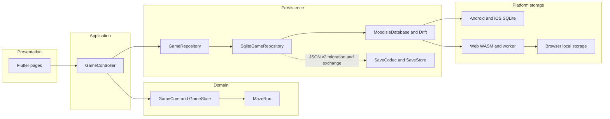
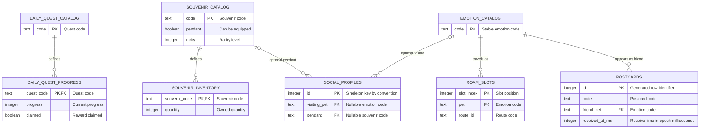
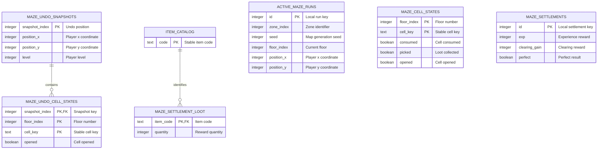

# Moodisle 本地 SQLite 数据库设计

_设计与实现说明｜依据 2026-10-16 的 Drift/SQLite 实现核对，2026-10-17 整理_

---

## 📋 设计目标与范围

Moodisle 将运行时自动存档从 JSON 整体文件迁移为**离线单机 SQLite 数据库**。数据库保存玩家进度、待办、伙伴、物品、专注状态、社交收藏和回廊进度；领域规则仍由纯 Dart 模块处理，页面通过 `GameController` 操作状态。当前没有用户账号、远程数据库或云同步。

本设计以代码中的 Drift schema v1 为准，覆盖 29 张关系表。JSON v2 仍作为人工导入/导出格式和旧存档迁移来源；JSON 格式版本与 SQLite schema 版本独立维护。主要实现位于 [database.dart](../app/lib/data/database.dart)、[game_repository.dart](../app/lib/data/game_repository.dart) 和 [game_controller.dart](../app/lib/application/game_controller.dart)。

系统范围、总体分层、功能模块和平台部署见[软件系统设计说明书](11-软件系统设计说明书.md)；本文聚焦关系模型、字段约束和持久化策略。

生产入口在 [main.dart](../app/lib/main.dart) 注入 `SqliteGameRepository`；`GameController` 通过构造参数接收 repository，未注入时保留 JSON `SaveStore` 路径，便于隔离不需要数据库的平台测试。

## 🧱 体系结构与功能模块

下图展示页面、领域逻辑、持久化接口和跨平台存储的依赖方向。`GameCore` 不依赖 Drift；SQLite 行结构在 repository 边界转换为 `GameState` 与活动 `MazeRun`。



### 功能模块层次

| 模块 | 主要职责 | 主要数据表 |
| --- | --- | --- |
| 静态目录 | 为情绪、道具、每日任务、纪念品提供稳定代码 | `emotion_catalog`、`item_catalog`、`daily_quest_catalog`、`souvenir_catalog` |
| 玩家与任务 | 保存档案、待办、伙伴记录和背包数量 | `player_profiles`、`tasks`、`pet_records`、`inventory` |
| 成长与日常 | 保存统计、连续记录、守护者、共鸣、气候、专注和每日任务 | `game_statistics`、`streak_states`、`keeper_states`、`resonance_states`、`climate_states`、`climate_days`、`focus_metadata`、`active_focus_sessions`、`daily_states`、`daily_quest_progress`、`achievement_unlocks` |
| 云游与社交 | 保存云游槽位、纪念品库存、展示资料和收到的明信片 | `roam_slots`、`souvenir_inventory`、`social_profiles`、`postcards` |
| 回廊运行时 | 保存当前运行、格子变化、撤销快照和结算奖励 | `active_maze_runs`、`maze_cell_states`、`maze_undo_snapshots`、`maze_undo_cell_states`、`maze_settlements`、`maze_settlement_loot` |
| 持久化适配 | 将内存领域状态映射成关系表，并以事务提交完整快照 | `SqliteGameRepository`、`MoodisleDatabase` |

## 🗂️ ER 分析

ER 图只画 schema 中声明的外键关系。玩家档案扩展状态和当前回廊的部分表虽然在业务上属于同一个存档，但目前使用单机约定和事务共同维护，没有在数据库层声明主外键；图中不把这种约定画成强制关系。

### 玩家、待办与库存

```mermaid
erDiagram
    accTitle: Player And Collection Relationships
    accDescr: Catalog foreign keys connect emotions and items to player profile, tasks, pets, focus, resonance, and inventory rows. Nullable catalog references remain optional in application data.

    EMOTION_CATALOG ||--o{ TASKS : "classifies"
    EMOTION_CATALOG ||--o{ PET_RECORDS : "identifies"
    EMOTION_CATALOG ||--o{ ACTIVE_FOCUS_SESSIONS : "accompanies"
    EMOTION_CATALOG o|--o{ RESONANCE_STATES : "optional emotion"
    EMOTION_CATALOG o|--o{ PLAYER_PROFILES : "optional companion"
    ITEM_CATALOG ||--o{ INVENTORY : "defines"

    EMOTION_CATALOG {
        text code PK "Stable emotion code"
    }
    ITEM_CATALOG {
        text code PK "Stable item code"
    }
    PLAYER_PROFILES {
        integer id PK "Local profile key"
        integer save_format_version "JSON compatibility version"
        text companion FK "Nullable emotion code"
    }
    TASKS {
        integer id PK "Task identifier"
        integer position "Display order"
        text emotion FK "Emotion code"
        integer difficulty "Difficulty from one to three"
        text status "Pending or done"
    }
    PET_RECORDS {
        text emotion PK, FK "Emotion code"
        integer count "Captured count"
        integer bond_minutes "Bond duration"
    }
    ACTIVE_FOCUS_SESSIONS {
        integer id PK "Singleton key by convention"
        text pet FK "Emotion code"
        integer plan_minutes "Planned duration"
    }
    RESONANCE_STATES {
        integer id PK "Singleton key by convention"
        text last_emotion FK "Nullable emotion code"
        integer length "Current length"
    }
    INVENTORY {
        text item_code PK, FK "Item code"
        integer quantity "Owned quantity"
    }
```



### 每日、云游与收藏



### 回廊状态与结算



回廊目前一局只保存一个 `id = 1` 的运行记录。`maze_cell_states`、`maze_settlements` 与结算掉落在保存事务中随运行状态整体替换，但没有 `run_id` 外键；若未来允许多局历史并存，应添加运行标识和外键，而不是继续依赖单局约定。

## 📐 表结构设计

下面的字段名使用 Dart 属性名；SQLite 列名按 Drift 命名策略转换为 `snake_case`。`?` 表示可空。类型按 Drift 列声明列出；SQLite 中布尔值以整数形式存储，日期时间采用 ISO 日期文本或 Unix epoch 毫秒整数。

### 目录与核心数据

| 表 | 字段及类型 | 主键 | 外键、约束与索引 | 用途 |
| --- | --- | --- | --- | --- |
| `emotion_catalog` | `code TEXT` | `code` | — | 情绪稳定代码目录 |
| `item_catalog` | `code TEXT` | `code` | — | 道具稳定代码目录 |
| `daily_quest_catalog` | `code TEXT` | `code` | — | 每日任务代码目录 |
| `souvenir_catalog` | `code TEXT`、`pendant BOOLEAN`、`rarity INTEGER` | `code` | — | 纪念品目录与分类属性 |
| `player_profiles` | `id INTEGER`、`saveFormatVersion INTEGER`、`nextTaskId INTEGER`、`clearing REAL`、`energy INTEGER`、`warmFrontTurns INTEGER`、`tailwindTurns INTEGER`、`companion TEXT?`、`onboarded BOOLEAN`、`lastReportWeek TEXT?` | `id` | `companion → emotion_catalog.code` | 单机玩家档案 |
| `tasks` | `id INTEGER`、`position INTEGER`、`taskText TEXT`、`emotion TEXT`、`difficulty INTEGER`、`status TEXT`、`createdOn TEXT`、`pinned BOOLEAN` | `id` | `emotion → emotion_catalog.code`；`position >= 0`；`difficulty` 为 1–3；`status` 为 `pending`/`done`；索引 `(status, createdOn)` | 待办与原列表顺序 |
| `pet_records` | `emotion TEXT`、`count INTEGER`、`branch TEXT?`、`bondMinutes INTEGER` | `emotion` | `emotion → emotion_catalog.code`；`count >= 0`；`bondMinutes >= 0` | 每种伙伴的已捕获数量、分支与羁绊时长 |
| `inventory` | `itemCode TEXT`、`quantity INTEGER` | `itemCode` | `itemCode → item_catalog.code`；`quantity >= 0` | 道具库存 |

### 成长、专注与日常状态

| 表 | 字段及类型 | 主键 | 外键、约束与索引 | 用途 |
| --- | --- | --- | --- | --- |
| `game_statistics` | `id INTEGER`、`totalDone INTEGER`、`totalFocusSessions INTEGER`、`totalFocusMinutes INTEGER`、`mazeRuns INTEGER`、`mistDewCollected INTEGER`、`deepDives INTEGER` | `id` | 单例 `id = 1` 由 repository 写入；未声明 profile 外键 | 累计统计 |
| `streak_states` | `id INTEGER`、`sunnyDays INTEGER`、`lastSunny TEXT?` | `id` | 单例 `id = 1` 由 repository 写入；未声明 profile 外键 | 连续晴日状态 |
| `keeper_states` | `id INTEGER`、`level INTEGER`、`exp INTEGER` | `id` | 单例 `id = 1` 由 repository 写入；未声明 profile 外键 | 守护者成长 |
| `resonance_states` | `id INTEGER`、`lastEmotion TEXT?`、`length INTEGER`、`best INTEGER`、`lastAtMs INTEGER?` | `id` | `lastEmotion → emotion_catalog.code`（可空）；单例 `id = 1` 由 repository 写入 | 共鸣状态 |
| `climate_states` | `id INTEGER`、`fog REAL`、`tier TEXT`、`tierHoldDays INTEGER`、`zeroDoneStreak INTEGER` | `id` | 单例 `id = 1` 由 repository 写入；未声明 profile 外键 | 当前气候状态 |
| `climate_days` | `date TEXT`、`done INTEGER`、`focusMinutes INTEGER` | `date` | — | 按日期保存的气候统计桶 |
| `focus_metadata` | `id INTEGER`、`todayMinutes INTEGER`、`weekMinutes INTEGER`、`weekStart TEXT?`、`glancesToday INTEGER` | `id` | 单例 `id = 1` 由 repository 写入；未声明 profile 外键 | 专注周期汇总 |
| `active_focus_sessions` | `id INTEGER`、`pet TEXT`、`planMinutes INTEGER`、`tierMultiplier REAL`、`phase TEXT`、`accumulatedSeconds INTEGER`、`startedAtMs INTEGER`、`lastTickAtMs INTEGER`、`pausedAtMs INTEGER?` | `id` | `pet → emotion_catalog.code`；单例 `id = 1` 由 repository 写入 | 可恢复的当前专注会话；`phase` 为 `focusing`、`glancing` 或 `screenLocked`，阶段值由应用状态机解释，不增加列或 schema 版本 |
| `daily_states` | `id INTEGER`、`date TEXT?`、`checkinDays INTEGER`、`checkinBest INTEGER`、`checkedToday BOOLEAN`、`lastCheckin TEXT?`、`lastGreet TEXT?`、`mazeToday INTEGER` | `id` | 单例 `id = 1` 由 repository 写入；未声明 profile 外键 | 签到、问候、每日回廊次数 |
| `daily_quest_progress` | `questCode TEXT`、`progress INTEGER`、`claimed BOOLEAN` | `questCode` | `questCode → daily_quest_catalog.code` | 每日任务进度与领取状态 |
| `achievement_unlocks` | `code TEXT`、`position INTEGER` | `code` | `position >= 0`；`code` 是主键，未声明成就目录外键 | 已解锁成就及解锁顺序 |

### 云游、纪念品与社交

| 表 | 字段及类型 | 主键 | 外键、约束与索引 | 用途 |
| --- | --- | --- | --- | --- |
| `roam_slots` | `slotIndex INTEGER`、`pet TEXT`、`routeId TEXT`、`startedAtMs INTEGER`、`durationMs INTEGER` | `slotIndex` | `pet → emotion_catalog.code` | 云游槽位与行程时间 |
| `souvenir_inventory` | `souvenirCode TEXT`、`quantity INTEGER` | `souvenirCode` | `souvenirCode → souvenir_catalog.code`；`quantity >= 0` | 纪念品库存 |
| `social_profiles` | `id INTEGER`、`myName TEXT`、`visitingPet TEXT?`、`visitingExpireMs INTEGER?`、`pendant TEXT?` | `id` | `visitingPet → emotion_catalog.code`；`pendant → souvenir_catalog.code`；单例 `id = 1` 由 repository 写入 | 名称、来访伙伴与当前挂饰 |
| `postcards` | `id INTEGER`、`code TEXT`、`friendName TEXT`、`friendPet TEXT`、`receivedAtMs INTEGER` | 自增 `id` | `friendPet → emotion_catalog.code`；索引 `receivedAtMs`；`code` 当前没有唯一约束 | 收到的明信片 |

### 回廊运行状态

| 表 | 字段及类型 | 主键 | 外键、约束与索引 | 用途 |
| --- | --- | --- | --- | --- |
| `active_maze_runs` | `id INTEGER`、`zoneIndex INTEGER`、`seed INTEGER`、`startLevel INTEGER`、`floorIndex INTEGER`、`positionX INTEGER`、`positionY INTEGER`、`level INTEGER`、`keys INTEGER`、`lanterns INTEGER`、`steps INTEGER`、`kills INTEGER`、`eliteKills INTEGER`、`bossBeaten BOOLEAN`、`usedUndo BOOLEAN`、`active BOOLEAN` | `id` | 单局约定 `id = 1`；未声明与格子或结算表的外键 | 当前回廊进度和种子 |
| `maze_cell_states` | `floorIndex INTEGER`、`cellKey TEXT`、`consumed BOOLEAN`、`picked BOOLEAN`、`opened BOOLEAN` | `(floorIndex, cellKey)` | — | 当前楼层格子变化 |
| `maze_undo_snapshots` | `snapshotIndex INTEGER`、`positionX INTEGER`、`positionY INTEGER`、`level INTEGER`、`keys INTEGER`、`steps INTEGER`、`kills INTEGER`、`eliteKills INTEGER`、`bossBeaten BOOLEAN` | `snapshotIndex` | — | 撤销历史中的玩家快照 |
| `maze_undo_cell_states` | `snapshotIndex INTEGER`、`floorIndex INTEGER`、`cellKey TEXT`、`consumed BOOLEAN`、`picked BOOLEAN`、`opened BOOLEAN` | `(snapshotIndex, floorIndex, cellKey)` | `snapshotIndex → maze_undo_snapshots.snapshotIndex`；删除快照时级联删除格子状态 | 撤销快照中的格子变化 |
| `maze_settlements` | `id INTEGER`、`exp INTEGER`、`clearingGain INTEGER`、`perfect BOOLEAN` | `id` | 单局约定 `id = 1`；未声明与运行表的外键 | 当前局结算 |
| `maze_settlement_loot` | `itemCode TEXT`、`quantity INTEGER` | `itemCode` | `itemCode → item_catalog.code`；`quantity >= 0` | 当前局掉落 |

## 💡 设计思路与质量分析

### 设计选择

- **领域与存储分层**：`GameCore` 和实体继续使用 Dart 类型；`SqliteGameRepository` 负责映射，不让页面或领域规则直接操作 SQL/Drift。
- **用稳定代码连接枚举**：情绪、道具、任务和纪念品用代码作主键，目录由当前规则配置播种，相关记录通过外键引用，避免把显示文案当标识。
- **按业务集合拆表**：任务、伙伴、物品、每日进度和迷宫撤销数据各自关系化；清单顺序单独保存 `position` 或 `slotIndex`，恢复时按顺序读取。
- **只保存源状态**：伙伴阶段/羁绊等级与迷宫地形由现有计数、规则和种子计算，不复制存储派生结果，减少双份数据不一致。
- **整份快照一次提交**：repository 在单个 SQLite 事务内更新目录引用、清理旧状态行并写入新状态。事务避免中间状态被提交；当前状态规模适合全量替换。
- **兼容现有存档**：SQLite schema 版本由 Drift 管理，JSON v2 继续用于手动导入/导出与首次迁移，两套版本号互不替代。

### 质量判断与当前边界

当前设计满足离线单机、跨平台复用、核心集合关系化和整份状态原子保存的目标。主外键、复合主键、少量关键 `CHECK` 约束及查询索引已经落在 schema 中；实现细节仍以 [database.dart](../app/lib/data/database.dart) 为准。

当前仍有几项数据完整性依赖应用代码：

- `game_statistics`、`streak_states`、`keeper_states`、`climate_states`、`focus_metadata`、`daily_states`、`social_profiles`、`active_focus_sessions`、`active_maze_runs` 和 `maze_settlements` 按单例键 `id = 1` 写入，但没有 `CHECK (id = 1)`，也没有统一的 `profile_id` 外键。新建单机档案的实现会保持约定；未来若支持多档案，应改为显式 `profile_id` 并加外键。
- 回廊当前格子、结算、奖励与运行记录由事务同时保存，但仅撤销格子对撤销快照有数据库外键。若保存多局历史，应引入 `run_id` 并约束关联。
- `postcards.code` 没有唯一索引；待办和成就 `position` 也没有唯一约束。当前数据由领域逻辑维护；如业务规则要求数据库拒绝重复明信片代码或重复顺序，后续需补约束和迁移。
- 多个计数和时间字段没有 SQL `CHECK` 范围约束，完整合法性部分依赖领域校验。扩展 schema 时可根据实际业务边界补约束。
- 当前 Flutter 自动化测试没有直接覆盖 `SqliteGameRepository` 的整状态往返或 SQLite schema 升级；CI 通过也不能单独证明 29 张表的映射没有遗漏。上线前应增加内存 SQLite 往返测试和旧 schema 升级样本验证。
- 当前 `schemaVersion` 为 1，`onUpgrade` 预留了迁移入口，尚无从旧 SQLite 版本升级的步骤。每次发布 schema 变更都需要提高版本、实现升级逻辑，并用旧版本数据库样本核对数据保留。Drift 的迁移入口与策略见官方迁移文档[^1]。
- 保存采用延迟约两秒的完整快照写入。该方案代码简单且事务边界清楚；若数据量或写入频率明显增长，再评估按实体增量更新，并验证突然终止时的可接受数据窗口。

这些边界不影响当前单用户模型的关系映射，但应作为后续增强项纳入评审；不能将“有外键”概括为“所有业务关系都由数据库强制”。

## 🔄 启动恢复与数据生命周期

```mermaid
flowchart TB
    accTitle: Save Restoration And Migration Flow
    accDescr: Startup first reads the SQLite profile. An empty database loads and validates the legacy JSON save before migrating it in a transaction; unreadable database access falls back to the legacy save path and reports a notice.

    start([Application startup]) --> db_read["Read SQLite profile"]
    db_read --> profile{ "Profile exists?" }
    profile -->|Yes| restore_db["Restore GameState and MazeRun"]
    profile -->|No| legacy["Load legacy JSON save"]
    legacy --> valid{ "Valid JSON v2?" }
    valid -->|Yes| migrate["Decode and write SQLite transaction"]
    valid -->|No| fresh["Create fresh state"]
    migrate --> running["Continue with SQLite"]
    fresh --> seed["Save initial state"]
    seed --> running
    restore_db --> running
    db_read -.->|Database read error| fallback["Use JSON fallback and show notice"]
    migrate -.->|Database write error| fallback
    seed -.->|Database write error| fallback
```

在空库首次启动时，控制器使用既有 `SaveCodec` 校验 JSON v2 主存档/备份，恢复领域状态后写入 SQLite。之后恢复优先读取 SQLite。若数据库读取或写入失败，会尝试旧 JSON 路径并显示提示。JSON 导入/导出仍走既有编解码器。数据库故障降级是否能恢复到最新状态取决于最近一次 JSON 写入，因此应保留用户导出的 JSON 备份。

Android/iOS 使用本机 SQLite 执行器；Web 随应用包提供匹配版本的 WASM 与 worker，由 Drift 在浏览器支持的本地存储实现间选择。浏览器限制可能导致持久化模式不同，隐私模式和多标签行为需要按目标浏览器验收；单次编译成功不证明刷新后存档可恢复。Drift 官方 Web 平台说明覆盖 WASM/worker、存储选择和浏览器支持边界[^2]。

## ✅ 版本与验证记录

| 项目 | 当前记录 |
| --- | --- |
| Drift schema | v1，首次建库创建全部表并播种目录 |
| JSON 存档 | v2，导入/导出和旧存档迁移 |
| 依赖版本 | `drift 2.35.2`、`drift_flutter 0.3.1`、`drift_dev 2.35.1` |
| 本地静态检查 | 2026-10-16：`flutter analyze --no-pub` 无问题 |
| 本地构建 | 2026-10-16：Web Release 与 Android arm64 Debug 构建成功 |
| 未覆盖验收 | Repository 整状态往返/SQLite 迁移测试、浏览器刷新恢复/隐私模式/多标签、Android 真机数据库迁移、iOS 签名与真机 |

**自动化边界：**工作流在推送 `main` 或向 `main` 发起 PR 时运行分析、Flutter 测试和资产/平台门禁。上述本地构建记录不等于浏览器或真机验收。iOS 构建工作流为手动触发，避免普通文档或数据库提交消耗 macOS 构建次数。

## 🔗 参考

[^1]: Drift. “Migrations”. https://drift.simonbinder.eu/migrations/
[^2]: Drift. “Web”. https://drift.simonbinder.eu/platforms/web/
[^3]: SQLite. “Foreign Key Support”. https://www.sqlite.org/foreignkeys.html

SQLite 连接在 `beforeOpen` 中显式执行 `PRAGMA foreign_keys = ON`，以启用 schema 中声明的外键约束[^3]。
