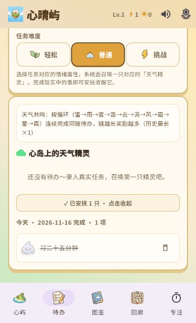

# 2026-11-16 多端共享改动验收

本轮在 `feat/wechat-miniprogram` 合并 Android/Web 主线 `418e705` 后实施。截图来自本地 Web release，独立测试地址 `http://localhost:8766`，不覆盖用户其他来源的存档。

## 已验证

- 本地 Flutter 测试 138/138 通过；analyze 零问题。
- 小程序开关 `true` 和 `1` 各运行 2 项测试并通过。
- Python 工具 13 项测试通过；PNG 278/278 校验通过；台账 322 项审计通过；清洁室扫描通过。
- Web release 构建通过；迷宫性能预算通过（1000 样本，最差 14.25ms < 50ms）。
- 浏览器实际新建任务 → 创建日期标题 → 复盘 → 收服 → 完成日期分组；刷新后任务、完成日期和伙伴仍在。
- 开始 25 分钟专注，倒计时和新场景正常显示；390×640 窗口无横向溢出，操作按钮可见。

## 证据边界

浏览器截图证明画面和交互可用，不代替音频实听或 Android/微信真机验收。自动停 BGM 与用户静音独立由界面测试守护。SQLite v1/v2 升级样本、专注恢复和完成日期持久化有自动化测试，但不声称完整覆盖全部 29 张表。

小程序源码复用相同页面和规则；新包必须由 Linux 工作流编译并通过开发者工具/真机走查。旧 2026-10-24 小程序包不是本轮验收证据。小程序仍无音频适配，Web/小程序隐藏即暂停，不能可靠区分自然息屏。

## GitHub 构建结果

源码提交 `d5ebe9abcb40c5366cedda576748008458a1c950`，已推送开发分支。

- [通用 CI 43887696402](https://github.com/kanosa0101/Moodisle/actions/runs/43887696402)：成功，包含 Linux 静态分析、138 项回归、构建参数、Web release 和资产检查。
- [小程序构建 43887740342](https://github.com/kanosa0101/Moodisle/actions/runs/43887740342)：成功，本轮只手动触发一次。
- 发布包 `weapp-spike.zip`：20,872,351 字节；SHA256 `64268fc282f99cf66fd67f5e193a0acc70358331590d2922c8a05bb04d609093`。
- 构建 AppID 为 `touristappid`，适用于开发者工具游客模式；本轮未完成微信真机验收。当前固定 prerelease 会被以后手动构建替换，追溯时以 run ID 和 SHA256 为准。

本节为构建后追加的文档记录，使用 `[skip ci]` 提交以避免重复构建；运行时代码仍以以上源码提交为准。
